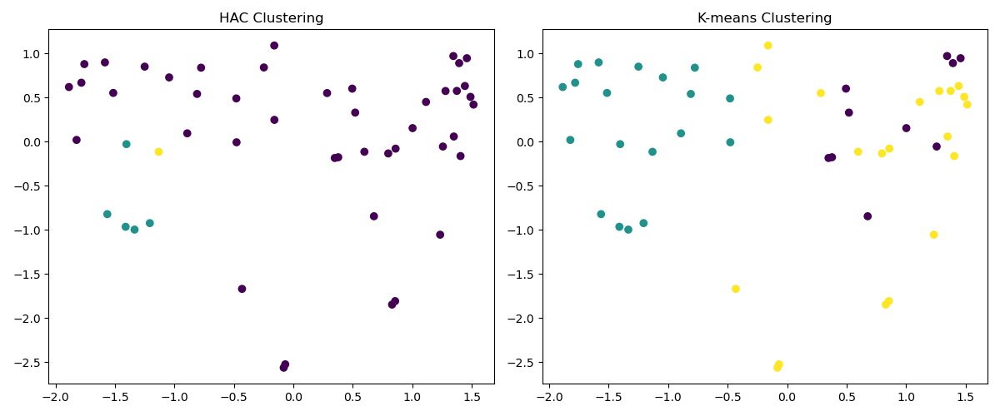
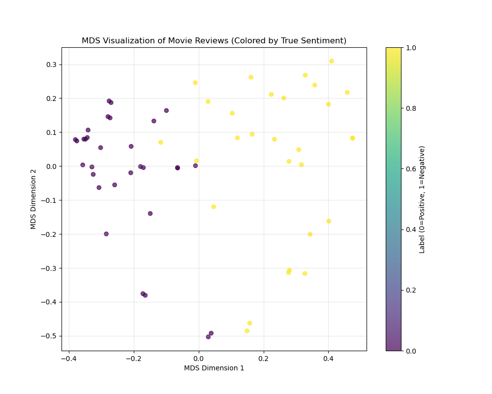

# Movie Review Clustering and Classification

A machine learning project exploring movie-review text through unsupervised clustering, dimensionality reduction, and text classification.

## Project Overview

The project implements a text-analysis pipeline to investigate how movie reviews can be represented and grouped using machine learning.

Key methods include:
- **Bag of Words:** Converts reviews into numerical feature vectors.
- **K-Means:** Groups reviews into clusters and evaluates different values of *k*.
- **Hierarchical Agglomerative Clustering (HAC):** Compares an alternative clustering approach.
- **Multidimensional Scaling (MDS):** Visualizes review similarities in a lower-dimensional space.
- **Inverse Document Frequency (IDF):** Examines the importance of words across reviews.
- **Naive Bayes and forward feature selection:** Explores text classification using selected features.

## Project Structure

```text
movie-review-clustering/
├── data/
│   └── movie_reviews.csv   # Local dataset; not tracked by Git
├── figures/
│   ├── hac-vs-kmeans.png
│   └── mds-visualization.png
├── src/
│   └── movies.py
├── .gitignore
└── README.md
```

## Requirements

- Python 3
- pandas
- NumPy
- Matplotlib

## How to Run

1. Clone the repository.
2. Install the required libraries:

   ```bash
   pip install pandas numpy matplotlib
   ```

3. Place `movie_reviews.csv` in the `data/` directory.
4. Run the script from the project root:

   ```bash
   python src/movies.py
   ```

## Results and Visualizations

### Hierarchical Clustering vs. K-Means



### MDS Visualization



## Notes

The dataset is excluded from version control. You must provide your own local copy of `data/movie_reviews.csv` to run the script.

This project was developed as part of a machine learning course.